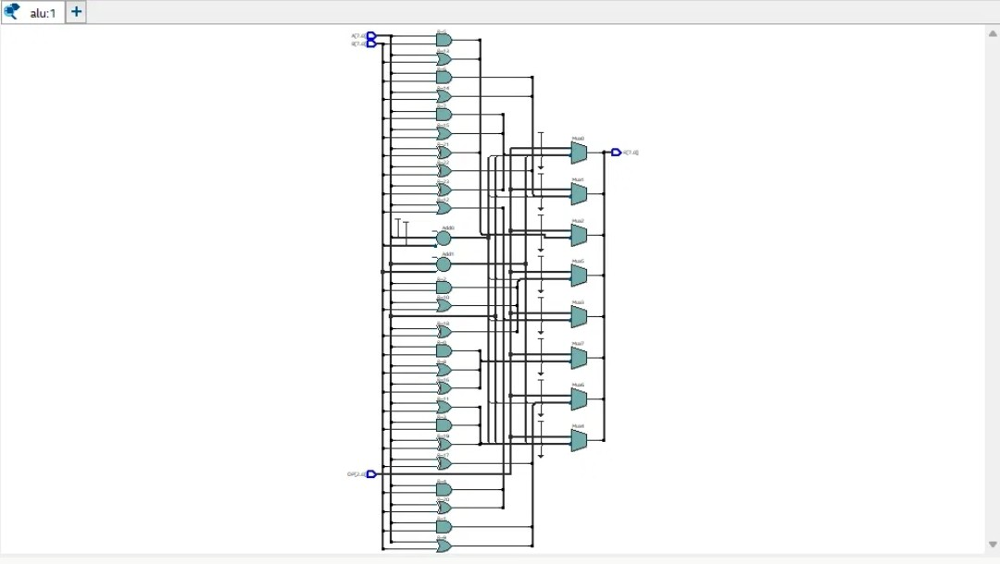
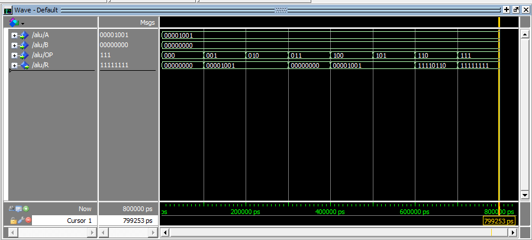

# 8-bit ALU in VHDL

I built this for my Computer Architecture course (ITCE362) at the University of Bahrain, where I'm studying Computer Engineering. It was the first lab of the course.

The idea is simple. An ALU is the part of a CPU that does the math and logic. Mine takes two 8-bit numbers, A and B, plus a 3-bit code called OP, and gives back an 8-bit result R. There's no clock, so the output just follows the inputs.

| OP | What it does | R |
|---|---|---|
| 000 | Clear | 00000000 |
| 001 | Subtract | A - B |
| 010 | Add | A + B |
| 011 | AND | A and B |
| 100 | OR | A or B |
| 101 | XOR | A xor B |
| 110 | Invert | not A |
| 111 | Set | 11111111 |

## Two versions of the same ALU

The lab asked us to write it with a `with ... select` statement, and then again using an `if` statement. So there are two files:

- [`src/alu.vhd`](src/alu.vhd) uses `with OP select`
- [`src/alu_if.vhd`](src/alu_if.vhd) uses `if / elsif` inside a process

They give the same answers, but they don't describe quite the same hardware. A select statement is basically a multiplexer, and every choice is equal. An if/elsif chain has priority built in, since the first condition that's true wins. Here the OP codes never overlap, so the priority doesn't matter for the output. It does change what the synthesized circuit looks like, though. A classmate's schematic looked completely different from mine, and that's what got me looking into this.

## What Quartus made of it



This is the RTL view from Quartus. It builds every operation at the same time: rows of AND, OR and XOR gates, one adder for A + B and another for A - B. Then a set of multiplexers (Mux0 to Mux7, one per output bit) uses OP to pick which result goes to R. So the ALU is always calculating all eight answers and just choosing one, which I didn't expect at first.

## Simulation

For the lab, each student used values from their own student ID. Mine gave A = 9 (00001001) and B = 0 (00000000). I stepped OP from 000 to 111, 100 ns each, in ModelSim:



| OP | Operation | R |
|---|---|---|
| 000 | Clear | 00000000 |
| 001 | A - B | 00001001 |
| 010 | A + B | 00001001 |
| 011 | A and B | 00000000 |
| 100 | A or B | 00001001 |
| 101 | A xor B | 00001001 |
| 110 | not A | 11110110 |
| 111 | Set | 11111111 |

Since B was 0, a lot of the answers came out as just A. That also means my lab test never checked a carry or a borrow, which bugged me a bit. So after the course I wrote a testbench that tries every possible input.

## Testing every input

`tb/tb_alu.vhd` goes through every A (0 to 255), every B (0 to 255) and every OP (0 to 7). That's 524,288 combinations, and it checks both versions of the ALU against the expected answer. Both pass. I also broke the subtraction on purpose to make sure the testbench actually catches mistakes, and it failed straight away.

If you have [GHDL](https://github.com/ghdl/ghdl) installed (`sudo apt install ghdl` on Ubuntu), you can run it yourself from the repo folder:

```bash
./scripts/run_tests.sh
```

```
=== tb_alu ===
  ALU PASSED: all 524288 input combinations correct for both ALU versions
All testbenches passed.
```

It also runs automatically on GitHub every time I push. If you'd rather look at the waveform, open ModelSim, change the directory to this folder and type `do sim/alu_sim.do`.

## Files

```
src/      alu.vhd, alu_if.vhd
tb/       tb_alu.vhd
sim/      alu_sim.do (the ModelSim script I used)
images/   screenshots from Quartus and ModelSim
scripts/  run_tests.sh
```

## What I took away from it

- Checking the RTL view is worth it. It shows what the tools actually built from my code, not just whether the simulation looks right.
- Adding and subtracting `std_logic_vector` only works because of the `STD_LOGIC_UNSIGNED` library, and 8-bit math wraps around (0 - 1 gives 255).
- Two pieces of code can behave exactly the same and still turn into different circuits.

Tools: VHDL, Intel Quartus Prime Lite 17.1, ModelSim Intel FPGA Starter Edition 10.5b, GHDL, GitHub Actions.
